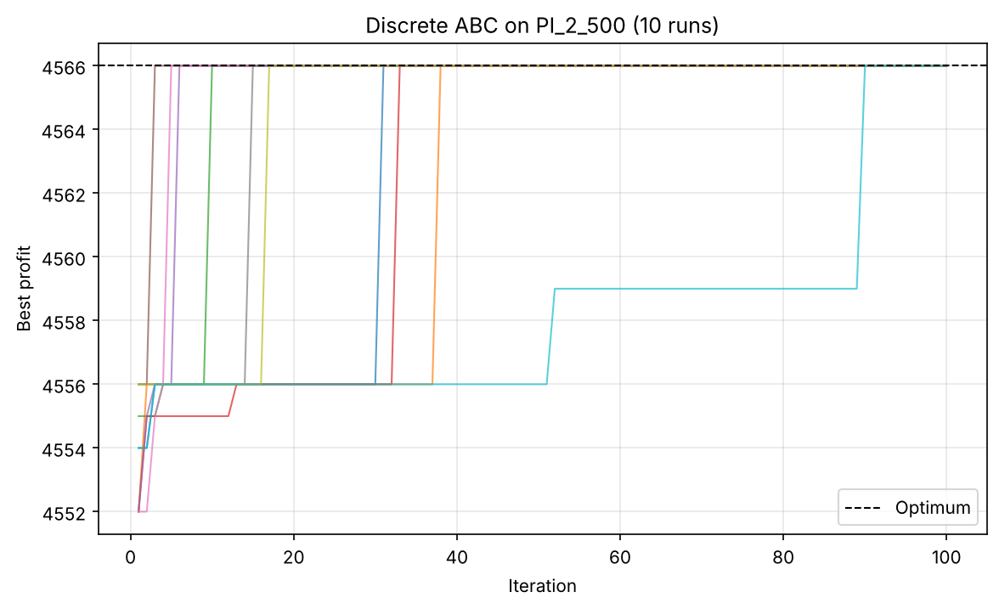
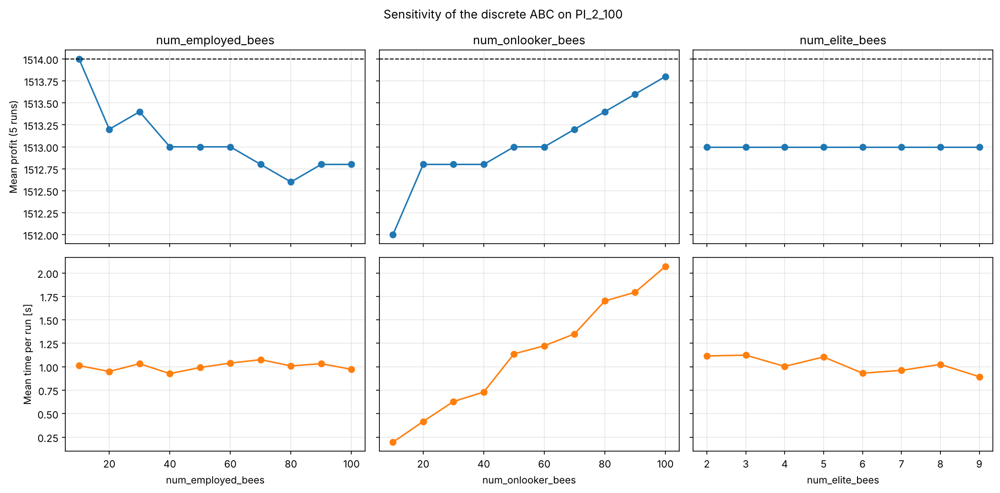

# A discrete Artificial Bee Colony algorithm for the 0-1 knapsack problem

Python implementation and evaluation of the binary Artificial Bee Colony (ABC) algorithm of Sabet, Farokhi and Shokouhifar (2012), tested on Pisinger benchmark instances with up to 10 000 items. A simpler bit-flip bee search is included as a baseline.

Developed for the course *Bionische Methoden* in the M.Sc. programme *Optimierung & Simulation* at Hochschule Bielefeld (HSBI), presented in December 2024.

## Problem

Given $N$ items with weights $w_i > 0$ and values $v_i > 0$ and a capacity $C$:

$$\max \sum_{i=1}^{N} v_i x_i \quad \text{s.t.} \quad \sum_{i=1}^{N} w_i x_i \le C, \quad x_i \in \{0,1\}.$$

## Method

Each food source is a binary vector with one bit per item.

1. **Greedy initialisation.** Items are packed in decreasing order of $v_i / w_i$ while they fit.
2. **Onlooker selection.** An onlooker chooses employed bee $k$ with probability proportional to $Ch_k = (F_k / \sum_i F_i)^{\mu}$ (elitist for $\mu \gg 1$).
3. **Recruitment.** The chosen bee receives $S_k = \beta\, Ch_k / H + \gamma$ soldiers ($\beta < 0$, $\gamma > 0$), i.e. neighbourhood trials.
4. **Neighbourhood search.** Every bit is flipped with probability $p_{change} = p_{min} + \frac{t}{t_{max}}(p_{max} - p_{min})$. Infeasible trials are repaired by removing the packed items with the lowest ratio $v_i / w_i$. A trial replaces the bee only if it is strictly better.

Parameters (as in the paper): 50 employed bees, 50 onlookers, $H = 5$, $\mu = 3$, $\beta = -10$, $\gamma = 16$, $p_{min} = 0.04$, $p_{max} = 0.12$, 100 iterations.

## Results

Ten independent runs per instance (`python scripts/run_benchmarks.py`). Type 1 = uncorrelated, 2 = weakly correlated, 3 = strongly correlated values and weights. All optima were verified by dynamic programming.

| Instance | Items | Optimum | Best | Mean | Runs at optimum | Time / run |
|---|---|---|---|---|---|---|
| P08 | 24 | 13 549 094 | 13 549 094 | 13 549 094 | 100 % | 0.6 s |
| PI_1_100 | 100 | 9 147 | 9 147 | 9 147 | 100 % | 0.9 s |
| PI_1_200 | 200 | 11 238 | 11 238 | 11 238 | 100 % | 1.3 s |
| PI_1_500 | 500 | 28 857 | 28 857 | 28 850.1 | 70 % | 1.7 s |
| PI_2_100 | 100 | 1 514 | 1 514 | 1 513.1 | 20 % | 1.0 s |
| PI_2_200 | 200 | 1 634 | 1 634 | 1 634 | 100 % | 1.3 s |
| PI_2_500 | 500 | 4 566 | 4 566 | 4 566 | 100 % | 1.8 s |
| PI_3_100 | 100 | 2 397 | 2 397 | 2 397 | 100 % | 0.9 s |
| PI_3_200 | 200 | 2 697 | 2 697 | 2 697 | 100 % | 1.2 s |
| PI_3_500 | 500 | 7 117 | 7 117 | 7 117 | 100 % | 1.8 s |

The optimum is reached in every run on 8 of the 10 instances; on the other two the mean gap is below 0.1 %. On several instances the algorithm finds *alternative* optimal solutions (different items, same total value).

<p align="center">
  
</p>

### Observations

- **Onlooker bees** drive the search: each onlooker triggers about 15 neighbourhood trials, so quality and runtime both grow with their number.
- **The number of elite bees $H$ has no effect** with these parameters: since $Ch_k \approx (1/50)^3 \approx 10^{-5}$, the term $\beta\, Ch_k / H$ is negligible and every selected bee gets 15 soldiers.
- **All employed bees start from the same greedy solution**, so diversity comes only from the neighbourhood search.
- **Large instances.** On PI_1_10000 the result (563 605) equals the greedy start: flipping 4–12 % of 10 000 bits per trial is too coarse to improve it. A flip probability that scales with the instance size would be the next step.



### Baseline

The bit-flip baseline (`notebooks/baseline_bitflip.ipynb`) starts from random solutions and gives infeasible solutions a profit of 0. It solves small instances but reaches the optimum of P08 only occasionally, and on PI_1_100, where the optimum packs only 12 of 100 items, it returns the trivial solution: almost every random solution is infeasible, so no trial is ever accepted. Greedy initialisation and repair, the key ingredients of the discrete ABC, remove this problem.

## Project structure

```
bee-knapsack/
├── src/bee_knapsack/
│   ├── abc.py           # discrete ABC (Sabet et al., 2012)
│   ├── baseline.py      # bit-flip bee search (baseline)
│   ├── instances.py     # instance catalog and file readers
│   └── experiments.py   # repeated runs, sensitivity, convergence plots
├── scripts/
│   ├── run_benchmarks.py    # results table
│   ├── plot_convergence.py  # convergence figure
│   └── sensitivity.py       # sensitivity figure
├── notebooks/
│   ├── abc_knapsack.ipynb      # main walkthrough
│   └── baseline_bitflip.ipynb  # baseline and its limitation
├── data/                # Pisinger instances (knapPI_*.txt)
├── figures/
├── pyproject.toml
└── requirements.txt
```

## Installation and usage

```bash
git clone https://github.com/<user>/bee-knapsack.git
cd bee-knapsack
pip install -e .

python scripts/run_benchmarks.py --runs 10          # add --large for PI_1_10000
python scripts/plot_convergence.py --instance PI_2_500
python scripts/sensitivity.py --instance PI_2_100
```

```python
from bee_knapsack import ArtificialBeeColony, load_pisinger

inst = load_pisinger("PI_2_500")
abc = ArtificialBeeColony(inst.weights, inst.values, inst.capacity, seed=0)
solution, profit = abc.optimize()
print(profit, inst.optimum)
```

## References

- S. Sabet, F. Farokhi, M. Shokouhifar (2012). *A Novel Artificial Bee Colony Algorithm for the Knapsack Problem.* IEEE.
- D. Pisinger. *Instances of 0/1 knapsack problem* (knapPI).
- J. Burkardt. *KNAPSACK_01: Data for the 01 knapsack problem* (P08).
- H. Kellerer, U. Pferschy, D. Pisinger (2004). *Knapsack Problems.* Springer.
